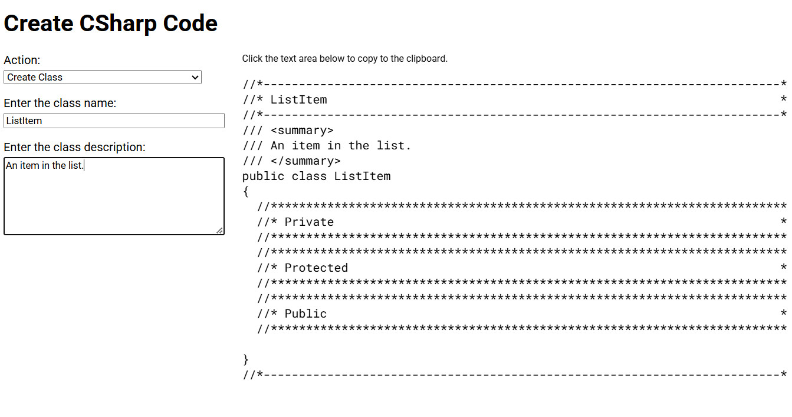

# CreateCS
RAD tool to quickly create perfectly formatted C# code block snippets by filling a few fields.

This is a single, local HTML/JavaScript file named **CreateCS.html** that can be copied and run anywhere.

## The Benefits of Code Formatting
Well-formatted code doesn't do anything for the processor. Cleanliness of code formatting is specifically meant for enhancing human productivty.

Pretty-code, as it has also been called, is a fundamental architectural discipline for long-term system maintenance. Well-structured code drastically reduces cognitive load during engineering lifecycles by aligning structural patterns with human visual processing. When code is well-formatted, it can be categorized, alphabetized, grouped, arranged, and re-arranged with very little effort.

By maintaining rigorous and clean formatting, teams benefit from these key operational advantages.

- **Streamlined Documentation and Metadata**. Formal formatting creates predictable, clean structural boundaries, making it significantly easier to attach formalized inline documentation (such as JSDoc, XML comments, or Docstrings) that maps cleanly to the language's native meta-information properties and reflection APIs.

- **Accelerated Feature Scanning**. Consistent indentation, strategic whitespace, and visual hierarchies allow engineers to skim thousands of lines of code and pinpoint target components instantly.

- **Intuitive Modular Organization**. Proper formatting naturally clusters code into distinct, logical snippets, making it obvious where one operational responsibility ends and the next begins.

- **Low-Friction Troubleshooting**. When a codebase follows predictable formatting patterns, anomalies, broken syntax loops, and logic flaws stand out immediately rather than hiding in visual clutter.

- **Seamless Collaboration and Onboarding**. Clean formatting democratizes code comprehension, ensuring that engineers of varying familiarity levels can confidently audit, review, and extend the system without getting bogged down by stylistic noise.
Ultimately, we format code for the human engineer who must read, debug, and maintain it tomorrow. Investing in mechanical readability directly minimizes technical debt and maximizes authoring velocity across the entire engineering lifecycle.

## General Usage
Use this tool to write more than 2,000 lines of 100% consistent code per day. It opens as a single, local HTML/JavaScript file for maximum portability on Linux and Windows.

Follow these steps to create a block of code.

 - Select a type of block to create from the **Action** drop-down list.
 - Enter appropriate values in the fields.
 - When the code block matches the needed output, click the code block to copy it to the clipboard.
 - Paste the copied code to your code editor.

